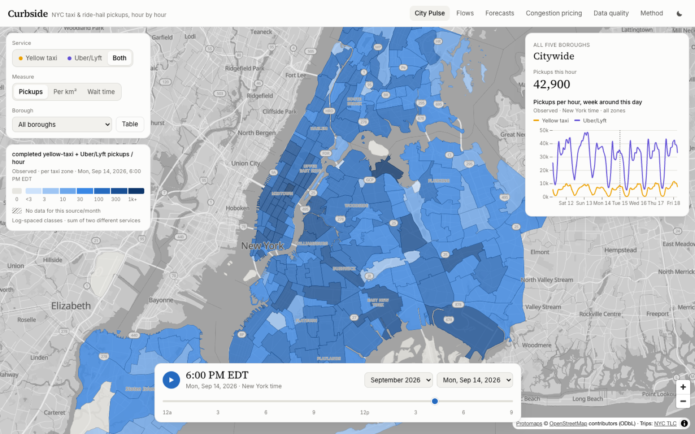
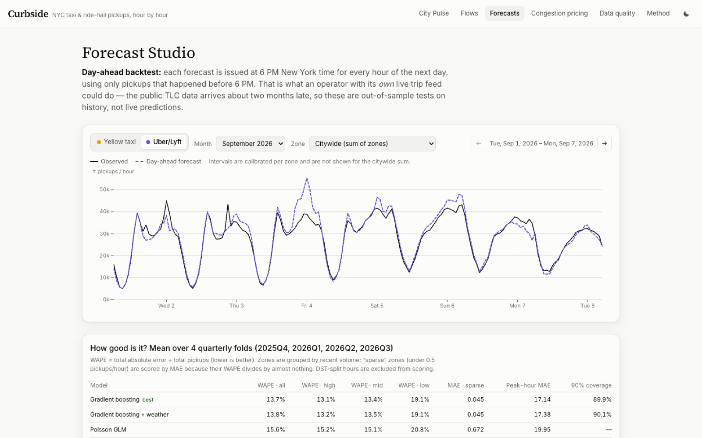

# Curbside AI
### New York City's taxi and ride-hail trips, hour by hour: where they start, where they go, and what models can honestly forecast

**Live site:** [curbside-ai.vercel.app](https://curbside-ai.vercel.app)

**Status:** complete. A static site built from local data; it can also be run locally (see Run it).



Curbside turns **1.07 billion** official NYC trip records (yellow taxis and Uber/Lyft, January 2023 – September 2026) into five views:

| View | What it shows |
|---|---|
| **City Pulse** | Hourly pickups in all 263 taxi zones on a scrubbable map: yellow taxis, Uber/Lyft or both, as counts, density or Uber/Lyft wait time |
| **Flows** | Where trips go: schematic links between zones (never street routes), top origin–destination pairs and a borough matrix |
| **Forecasts** | Day-ahead forecasts per zone and hour, with 90% intervals, tested out of sample against seasonal baselines, plus a frozen live forecast scored when TLC publishes |
| **Congestion pricing** | Did trips inside the January 2025 toll zone get faster? An explicit design, with placebo checks that say where the data stops |
| **Data quality** | How every number reconciles with TLC's own published totals, plus the validation flags and daylight-saving checks |

## Headline results

- **Warehouse:**
  - 45 months × 2 sources with no row silently dropped
  - Uber/Lyft monthly zone totals reproduce TLC's own aggregate within 0.5% in 44 of 45 months; 79% of zone-months match exactly
- **Forecasting:**
  - gradient boosting cuts error (WAPE) by **15%** against the best seasonal baseline, for both services, in every quarterly test fold
  - 90% intervals achieve 88–92% coverage
  - zone-network features add another 0.7–2%
  - weather forecasts add nothing measurable, an honest null
- **Congestion pricing:**
  - for Uber/Lyft, trip pace inside the toll zone changed little relative to the outer boroughs (−0.3%, or −3.3% if the pre-2025 drift is extrapolated)
  - for yellow taxis, a placebo test fails, so no causal claim is made



## What Curbside does not claim

- **Not all travel.** TLC trips only: no subway, bus, private cars or bikes.
- **Not traffic.** Pickups measure service use; trip pace is a proxy along the routes those trips took.
- **Not real-time.** TLC publishes monthly with about a two-month delay. The day-ahead forecasts are backtests of what an operator with its own live feed could do.
- **Not causal by default.** The policy study reports its placebo checks and stops where they fail.
- **Not GPS.** Locations are taxi zones; flows are schematic links between zone centres.

## Run it

Requirements: [uv](https://docs.astral.sh/uv/), Node 20+, about 25 GB of free disk for a full build (HVFHV raw files are pruned after verification).

```bash
make help            # all targets
make data            # download + validate + aggregate + reconcile + QA (~1.5 h, mostly download)
make basemap         # self-hosted NYC basemap (36 MB)
make forecast        # forecasting backtests + frozen live forecast (~1–2 h)
make policy          # congestion-pricing study (~2 min)
make web && make dev # http://localhost:5173
make check           # lint + 40 Python tests + browser tests (smoke, accessibility, performance, visual)
```

Every month: `uv run curbside refresh` (a dry run by default; add `--apply`). It ingests new months, re-reconciles, scores the frozen forecast and freezes the next one.

## How it's built

```text
TLC Parquet (yellow, HVFHV) + taxi zones            Open-Meteo forecasts (≥48 h old)
        │  SHA-256 manifest, schema checks                   │
        ▼                                                    │
Silver: every trip, 11 validation flags                      │
        ▼  hour calendar (DST-safe), invariants              │
Gold: zone × hour × source (explicit zeros), daily OD        │
        ├──► reconciliation vs TLC aggregate, QA report      │
        ├──► forecasting (backtests, conformal intervals) ◄──┘
        ├──► graph features, policy study
        ▼
Static artifacts (binary month files, JSON) ──► React + MapLibre + Observable Plot (no server)
```

- **Pipeline:** Python 3.12, uv, DuckDB, Polars, scikit-learn, pytest, Ruff
- **App:** Vite, React, TypeScript, MapLibre GL, Observable Plot, Tailwind, Playwright, axe-core
- **Basemap:** a self-hosted Protomaps extract

## Documentation

- [Technical report](docs/report.md): the whole project in one read
- By topic: [Warehouse](docs/warehouse.md) · [Web app](docs/web.md) · [Forecasting](docs/forecasting.md) · [Flows](docs/flows.md) · [Congestion pricing](docs/policy.md)
- [Data contract](docs/DATA_CONTRACT.md): data semantics, schemas and validation rules

## Data and attribution

- **Trip data and taxi zones:** [NYC Taxi & Limousine Commission](https://www.nyc.gov/site/tlc/about/tlc-trip-record-data.page). TLC makes no representations as to the accuracy of these data. Curbside is not affiliated with or endorsed by the City of New York or TLC.
- **Basemap:** © [OpenStreetMap](https://www.openstreetmap.org/copyright) contributors (ODbL), via [Protomaps](https://protomaps.com).
- **Weather inputs:** [Weather data by Open-Meteo.com](https://open-meteo.com/), licensed [CC BY 4.0](https://creativecommons.org/licenses/by/4.0/); used unmodified as forecast-model inputs.
- Only aggregates are published, never individual trips.

## Licence

Code is released under the [MIT licence](LICENSE). Data, basemap and weather inputs keep their own terms, listed above; third-party software and font notices are generated into the built site as `THIRD_PARTY_NOTICES.txt`.
